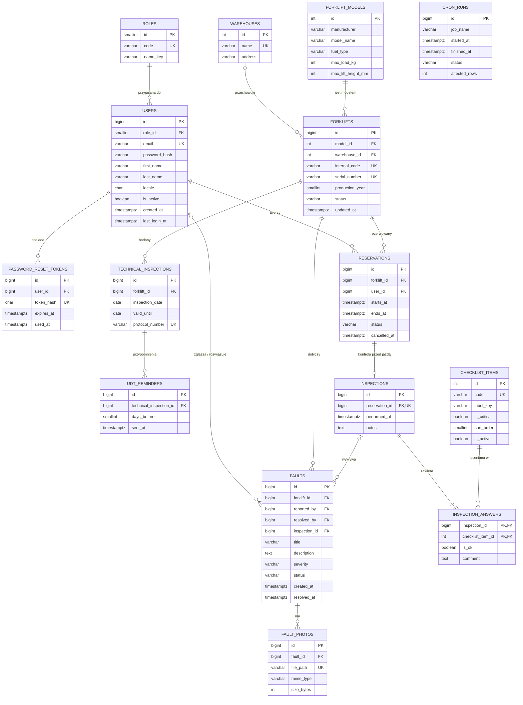

# Cargo — plan budowy aplikacji

> System do zarządzania flotą wózków widłowych w magazynie: rezerwacje na zmianę, kontrola przed jazdą, zgłaszanie usterek ze zdjęciami oraz pilnowanie terminów badań UDT.
>
> Oznaczenia `[K1]` … `[K36]` to numery kryteriów z `wymagania.txt`. Każde zadanie wskazuje, za które kryterium daje punkty.

---

## 1. Decyzje do podjęcia przed startem

- [ ] Skład zespołu i podział odpowiedzialności (trafi do README, sekcja „Autorzy i zakres odpowiedzialności”) `[K1]` `[K7]`
- [ ] Pobrać od prowadzącego kartę **Security Bingo** i sprawdzić, jakie pola dokładnie zawiera `[K27]`
- [ ] Hosting produkcyjny `[K36]`
  - **Rekomendacja:** VPS + Docker Compose + Caddy (automatyczny HTTPS). Na produkcji działa ten sam `docker-compose`, więc cron, uploady i Postgres zachowują się tak samo jak lokalnie.
  - Alternatywa: Azure for Students (App Service for Containers + Azure Database for PostgreSQL + Key Vault). Bardziej „korporacyjne”, ale trudniej postawić cron i trwałe uploady.
- [ ] Produkcyjny serwer SMTP, np. darmowy plan Brevo / Mailgun / Resend `[K33]`
- [ ] Czy dokładamy opcjonalną trzecią rolę `MECHANIC` (w wersji podstawowej usterki obsługuje `ADMIN`) `[K23]`
- [ ] Termin oddania i demo → rozpisać etapy z sekcji 9 na tygodnie

---

## 2. Wymagania funkcjonalne

### 2.1 Role

| Rola | Uprawnienia |
|---|---|
| `OPERATOR` | Przegląda wózki i ich dostępność. Rezerwuje wózek i anuluje własną rezerwację przed jej rozpoczęciem. Wykonuje kontrolę przed jazdą dla własnej rezerwacji. Zgłasza usterki ze zdjęciami. Widzi **tylko swoje** rezerwacje i zgłoszenia. |
| `ADMIN` (kierownik) | Widzi wszystko. Zarządza wózkami (dodawanie, edycja, zmiana statusu) i badaniami UDT. Tworzy i dezaktywuje konta użytkowników. Obsługuje usterki, czyli zmienia ich status. Ma dostęp do raportu miesięcznego i logu zadań CRON. |
| `MECHANIC` *(opcjonalnie)* | Obsługuje usterki, ale nie zarządza użytkownikami ani wózkami. |

### 2.2 Funkcje

| # | Funkcja | Kto |
|---|---|---|
| F1 | Logowanie, wylogowanie, reset hasła przez e-mail | wszyscy |
| F2 | Dashboard. Operator: najbliższe rezerwacje i wózki dostępne teraz. Admin: wózki wyłączone z eksploatacji, otwarte usterki, badania UDT wygasające w ciągu 30 dni | wszyscy |
| F3 | Lista wózków z filtrami (status, magazyn, napęd, minimalny udźwig, wyszukiwanie po frazie) i paginacją przez query params | wszyscy |
| F4 | Szczegóły wózka: dane i model, ważność UDT, otwarte usterki, **oś dostępności na wybrany dzień** (Fetch GET) | wszyscy |
| F5 | Utworzenie rezerwacji z poziomu szczegółów wózka (**Fetch POST**, bez przeładowania strony) | OPERATOR |
| F6 | Moje rezerwacje i anulowanie rezerwacji przed jej startem | OPERATOR |
| F7 | Kontrola przed jazdą: checklista dla rezerwacji | OPERATOR |
| F8 | Zgłoszenie usterki z 1–3 zdjęciami | OPERATOR |
| F9 | Obsługa usterek: lista z filtrami, zmiana statusu przez Fetch, notatka z naprawy | ADMIN |
| F10 | Zarządzanie wózkami | ADMIN |
| F11 | Rejestr badań UDT (data badania, ważność, numer protokołu) | ADMIN |
| F12 | Zarządzanie użytkownikami: nowe konto → e-mail z linkiem do ustawienia hasła; dezaktywacja konta | ADMIN |
| F13 | Raport miesięczny: godziny pracy i liczba usterek dla każdego wózka (z widoku SQL) | ADMIN |
| F14 | Przełącznik języka PL/EN i przełącznik motywu jasny/ciemny | wszyscy |
| F15 | Zadania CRON: przypomnienia UDT, zamykanie zakończonych rezerwacji, czyszczenie wygasłych tokenów | system |

### 2.3 Reguły biznesowe

- **R1** Nie można zarezerwować wózka o statusie `OUT_OF_SERVICE` ani `RETIRED`.
- **R2** Nie można zarezerwować wózka, którego badanie UDT nie obejmuje całego okresu rezerwacji.
- **R3** Rezerwacje jednego wózka nie mogą na siebie nachodzić. Pilnuje tego transakcja z `SELECT … FOR UPDATE`, a dodatkowo constraint `EXCLUDE` w bazie.
- **R4** Rezerwacja nie może zaczynać się w przeszłości. Trwa od 30 minut do 12 godzin i można ją założyć najwyżej 14 dni do przodu.
- **R5** Operator nie może mieć dwóch nakładających się rezerwacji, bo nie poprowadzi dwóch wózków naraz.
- **R6** Kontrolę przed jazdą wykonuje tylko właściciel rezerwacji, jeden raz, w oknie od 30 minut przed startem do końca rezerwacji.
- **R7** Odpowiedź „NIE OK” przy pozycji checklisty oznaczonej jako krytyczna automatycznie tworzy usterkę `CRITICAL`.
- **R8** Usterka `CRITICAL` uruchamia **trigger**: wózek dostaje status `OUT_OF_SERVICE`, a jego przyszłe aktywne rezerwacje są anulowane. Admini dostają e-mail.
- **R9** Operator ma dostęp tylko do własnych rezerwacji i usterek. Cudzy zasób zwraca 403 (ochrona przed IDOR).
- **R10** Dozwolone przejścia statusów usterki: `OPEN → IN_PROGRESS → RESOLVED` oraz `OPEN/IN_PROGRESS → REJECTED`. Gdy zamknięta zostanie ostatnia otwarta usterka krytyczna, wózek wraca do `AVAILABLE` (w transakcji).
- **R11** Nieaktywne konto nie może się zalogować. Sesja konta dezaktywowanego w trakcie pracy wygasa przy jego następnym żądaniu.

---

## 3. Wymagania techniczne

| Obszar | Wybór | Kryteria |
|---|---|---|
| Język backendu | **PHP 8.4** (wspierana wersja), `declare(strict_types=1)`, typowane właściwości, enumy, `readonly` | K5, K13 |
| Framework | **Brak.** Własny router, kontener DI, sesje i widoki. To elementy oceniane, więc muszą być widoczne w kodzie | K3, K4, K5 |
| Baza | **PostgreSQL 17** przez PDO (`ERRMODE_EXCEPTION`, prepared statements) | K10, K11, K25, K26 |
| Serwer WWW | Nginx + PHP-FPM | K2 |
| Zależności (Composer) | `phpmailer/phpmailer`; dev: `phpunit/phpunit` (opcjonalnie `phpstan`, `php-cs-fixer`) | K13, K31, K33 |
| Frontend | Szablony PHP, czysty CSS (custom properties), vanilla JS w modułach ES. Bez bundlera | K9, K14–K19 |
| Poczta | PHPMailer + SMTP. Lokalnie Mailpit | K33 |
| Cron | Osobny kontener z tym samym obrazem PHP i **supercronic** (w przeciwieństwie do busybox `crond` przekazuje zmienne środowiskowe do zadań) | K32 |
| Testy | PHPUnit 12, tylko testy jednostkowe z izolowanymi zależnościami (repozytoria in-memory) | K31 |
| Konteneryzacja | Docker Compose: `web`, `app`, `db`, `cron`, `mailpit` | K2 |

---

## 4. Architektura

```
Przeglądarka (HTML + JS/Fetch)
        │
        ▼
public/index.php ──► Kernel ──► Router ──► Middleware (Session → Auth → Role → CSRF)
                                               │
                                               ▼
                                         Controller          (odczyt Request, wywołanie serwisu, zwrot Response)
                                               │
                                               ▼
                                         Service             (logika biznesowa, reguły R1–R11, transakcje)
                                               │
                                               ▼
                                  RepositoryInterface        (kontrakt)
                                               │
                                               ▼
                                     Pg*Repository           (SQL z parametrami, mapowanie wiersz → encja)
                                               │
                                               ▼
                                          PostgreSQL
```

**Kierunek zależności:** Controller → Service → RepositoryInterface ← PgRepository. Kontroler nie zawiera SQL ani HTML. Widok dostaje gotowe dane i niczego nie pobiera sam. Serwisy zależą od interfejsów, więc w testach podmieniamy repozytoria na wersje in-memory.

**Przepływ do pokazania na demo:** `POST /api/reservations`

1. `reservation.js` przechwytuje submit, waliduje formularz po stronie klienta i wysyła `fetch` z JSON-em oraz nagłówkiem `X-CSRF-Token`.
2. `Router` dopasowuje metodę i ścieżkę, potem uruchamia middleware `Auth`, `Role(OPERATOR)` i `Csrf`.
3. `ReservationApiController::store()` buduje `CreateReservationCommand` z danych żądania.
4. `ReservationService::create()` sprawdza reguły R4 i R5, otwiera transakcję, blokuje wiersz wózka (`SELECT … FOR UPDATE`), sprawdza R1–R3 (funkcja `fn_forklift_is_available`) i wykonuje `INSERT`.
5. `PgReservationRepository` wykonuje zapytanie z parametrami.
6. Odpowiedź: `201` z JSON-em rezerwacji, `409` przy konflikcie terminów lub `422` z przetłumaczonymi błędami walidacji. JS aktualizuje oś dostępności i pokazuje komunikat w regionie `aria-live`.

---

## 5. Model danych

### 5.1 Tabele

| Tabela | Kolumny (najważniejsze) | Ograniczenia |
|---|---|---|
| `roles` | `id`, `code`, `name_key` | `code` UNIQUE, CHECK `code IN ('OPERATOR','ADMIN')` (`MECHANIC` dopisujemy, jeśli zapadnie taka decyzja) |
| `users` | `id`, `role_id`, `email`, `password_hash`, `first_name`, `last_name`, `locale`, `is_active`, `created_at`, `last_login_at` | UNIQUE na `lower(email)`, CHECK `locale IN ('pl','en')` |
| `password_reset_tokens` | `id`, `user_id`, `token_hash` (SHA-256), `expires_at`, `used_at` | `token_hash` UNIQUE |
| `warehouses` | `id`, `name`, `address` | `name` UNIQUE |
| `forklift_models` | `id`, `manufacturer`, `model_name`, `fuel_type`, `max_load_kg`, `max_lift_height_mm` | UNIQUE(`manufacturer`,`model_name`), CHECK `max_load_kg > 0`, CHECK `fuel_type IN ('ELECTRIC','LPG','DIESEL')` |
| `forklifts` | `id`, `model_id`, `warehouse_id`, `internal_code` (np. `WD-01`), `serial_number`, `production_year`, `status`, `created_at`, `updated_at` | `internal_code`, `serial_number` UNIQUE, CHECK `status IN ('AVAILABLE','OUT_OF_SERVICE','RETIRED')` |
| `technical_inspections` | `id`, `forklift_id`, `inspection_date`, `valid_until`, `protocol_number`, `notes` | CHECK `valid_until > inspection_date`, `protocol_number` UNIQUE |
| `udt_reminders` | `id`, `technical_inspection_id`, `days_before`, `sent_at` | UNIQUE(`technical_inspection_id`,`days_before`): dzięki temu CRON jest idempotentny |
| `reservations` | `id`, `forklift_id`, `user_id`, `starts_at`, `ends_at`, `status`, `created_at`, `cancelled_at` | CHECK `ends_at > starts_at`, CHECK `status IN ('ACTIVE','CANCELLED','COMPLETED')`, **EXCLUDE USING gist** (`forklift_id WITH =`, `tstzrange(starts_at, ends_at) WITH &&`) WHERE `status = 'ACTIVE'` (wymaga `btree_gist`) |
| `checklist_items` | `id`, `code`, `label_key`, `is_critical`, `sort_order`, `is_active` | `code` UNIQUE |
| `inspections` | `id`, `reservation_id`, `performed_at`, `notes` | `reservation_id` UNIQUE: jedna kontrola na rezerwację |
| `inspection_answers` | `inspection_id`, `checklist_item_id`, `is_ok`, `comment` | PK(`inspection_id`,`checklist_item_id`) |
| `faults` | `id`, `forklift_id`, `reported_by`, `inspection_id`, `title`, `description`, `severity`, `status`, `created_at`, `resolved_at`, `resolved_by`, `resolution_note` | CHECK `severity IN ('LOW','MEDIUM','CRITICAL')`, CHECK `status IN ('OPEN','IN_PROGRESS','RESOLVED','REJECTED')` |
| `fault_photos` | `id`, `fault_id`, `file_path` (ścieżka względna), `original_name`, `mime_type`, `size_bytes`, `uploaded_at` | CHECK `size_bytes > 0`, `file_path` UNIQUE |
| `cron_runs` | `id`, `job_name`, `started_at`, `finished_at`, `status`, `affected_rows`, `message` | CHECK `status IN ('RUNNING','SUCCESS','FAILED')`, `finished_at` ustawione dla zakończonych |

**Normalizacja:** stan „zarezerwowany teraz” **nie jest przechowywany**, tylko wyliczany z `reservations`. Wynik kontroli (zaliczona/niezaliczona) też jest wyliczany z `inspection_answers`. Dane modelu (producent, udźwig) siedzą w `forklift_models`, a nie w każdym wózku. Kontrola nie przechowuje `forklift_id` ani `user_id`, bo wynikają z rezerwacji.

### 5.2 Klucze obce i zachowanie ON DELETE `[K26]`

| FK | ON DELETE | Uzasadnienie |
|---|---|---|
| `users.role_id → roles` | RESTRICT | Nie usuwamy roli, do której są przypisani użytkownicy |
| `password_reset_tokens.user_id → users` | CASCADE | Token nie ma sensu bez użytkownika |
| `forklifts.model_id → forklift_models` | RESTRICT | Nie usuwamy modelu, który ma wózki |
| `forklifts.warehouse_id → warehouses` | SET NULL | Po likwidacji magazynu wózek zostaje, tylko „bez przypisania” |
| `technical_inspections.forklift_id → forklifts` | CASCADE | Badania są częścią wózka |
| `udt_reminders.technical_inspection_id → technical_inspections` | CASCADE | Log przypomnień należy do badania |
| `reservations.forklift_id → forklifts` | RESTRICT | Historia użycia jest ważna. Wózek wycofujemy statusem `RETIRED` |
| `reservations.user_id → users` | RESTRICT | Konta dezaktywujemy (`is_active`), a nie usuwamy |
| `inspections.reservation_id → reservations` | CASCADE | Kontrola istnieje tylko w ramach rezerwacji |
| `inspection_answers.inspection_id → inspections` | CASCADE | Odpowiedzi są częścią kontroli |
| `inspection_answers.checklist_item_id → checklist_items` | RESTRICT | Pozycję checklisty dezaktywujemy, a nie usuwamy |
| `faults.forklift_id → forklifts` | RESTRICT | Historia usterek jest ważna |
| `faults.reported_by / resolved_by → users` | SET NULL | Zgłoszenie zostaje, nawet gdy autora już nie ma |
| `faults.inspection_id → inspections` | SET NULL | Usterka może istnieć bez kontroli |
| `fault_photos.fault_id → faults` | CASCADE | Zdjęcia są częścią zgłoszenia (pliki usuwa serwis) |

### 5.3 Widoki, funkcje, triggery i transakcje `[K25]`

- [ ] **Widok** `v_forklift_overview`: wózek + model + magazyn + liczba otwartych usterek + `udt_valid_until` + `is_udt_valid`. Korzystają z niego lista wózków i dashboard.
- [ ] **Widok** `v_monthly_usage`: dla każdego wózka i miesiąca suma godzin rezerwacji `COMPLETED` i liczba usterek. Korzysta z niego raport admina.
- [ ] **Funkcja** `fn_forklift_is_available(p_forklift_id, p_from, p_to) RETURNS boolean`: sprawdza status, ważność UDT i kolizje rezerwacji.
- [ ] **Trigger** `trg_fault_critical_after_insert`: przy usterce `CRITICAL` ustawia wózkowi `OUT_OF_SERVICE` i anuluje jego przyszłe aktywne rezerwacje (R8).
- [ ] **Trigger** `trg_set_updated_at` na tabeli `forklifts`.
- [ ] **Transakcja** w `ReservationService::create()` (R1–R3), zarządzana z PHP: `beginTransaction` + `FOR UPDATE`.
- [ ] **Transakcja** w `InspectionService::submit()`: kontrola, odpowiedzi i ewentualna usterka zapisują się atomowo.
- [ ] **Transakcja** w `FaultService::changeStatus()`: zmiana statusu usterki i ewentualny powrót wózka do `AVAILABLE` (R10).

### 5.4 ERD (szkic, po implementacji trafi do README) `[K6]`



### 5.5 Dane demonstracyjne `[K12]`

- 2 magazyny, 4 modele (elektryczny, LPG, diesel, wózek wysokiego składowania), 8 wózków:
  - 5 × `AVAILABLE`,
  - 1 × `OUT_OF_SERVICE` z otwartą usterką krytyczną,
  - 1 z badaniem UDT wygasającym za ok. 10 dni (pod demo CRON),
  - 1 z wygasłym badaniem UDT (pod demo reguły R2).
- Konta: `admin@cargo.local`, `operator@cargo.local`, `operator2@cargo.local`, `nieaktywny@cargo.local`. W seedzie są tylko hashe haseł, a jawne hasła demo podajemy w README.
- 10 pozycji checklisty (4 krytyczne), rezerwacje przeszłe, bieżące i przyszłe, kilka usterek w różnych statusach. Zdjęcia do usterek dojdą w etapie 8 razem z uploadem.
- Wszystkie dane są fikcyjne, bez prawdziwych danych osobowych.

---

## 6. Routing i endpointy `[K4]`

Router kompiluje wzorce do wyrażeń regularnych: `{name}` daje `(?P<name>[^/]+)`, a `{name:regex}` daje `(?P<name>regex)`. Gdy ścieżka pasuje, a metoda nie, zwraca **405**. Gdy nic nie pasuje: **404**. Identyfikatory waliduje w kontrolerze klasa `IdParam`: wartość nie będąca dodatnią liczbą całkowitą daje **400**, a nieistniejący rekord daje **404**.

| Metoda | Ścieżka | Kontroler | Dostęp | Pokazuje |
|---|---|---|---|---|
| GET | `/` | `HomeController::index` | wszyscy | przekierowanie |
| GET/POST | `/login` | `AuthController` | gość | **trasa statyczna** |
| POST | `/logout` | `AuthController::logout` | zalogowany | CSRF |
| GET/POST | `/forgot-password` | `PasswordResetController` | gość | e-mail |
| GET/POST | `/reset-password?token=…` | `PasswordResetController` | gość | query param |
| GET | `/lang/{locale:pl\|en}` | `LocaleController::switch` | wszyscy | **regex pattern** |
| GET | `/dashboard` | `DashboardController::index` | zalogowany | |
| GET | `/forklifts?status=&warehouse=&fuel=&min_load=&q=&page=` | `ForkliftController::index` | zalogowany | **query params** |
| GET | `/forklifts/{id}` | `ForkliftController::show` | zalogowany | **path param, 400/404** |
| GET | `/reservations?status=` | `ReservationController::index` | zalogowany | operator: własne, admin: wszystkie |
| POST | `/reservations/{id}/cancel` | `ReservationController::cancel` | właściciel | 403 dla cudzej |
| GET/POST | `/reservations/{id}/inspection` | `InspectionController` | właściciel | transakcja |
| GET | `/faults?status=&severity=` | `FaultController::index` | zalogowany | |
| GET/POST | `/faults/new?forklift=` | `FaultController` | OPERATOR | upload |
| GET | `/faults/{id}` | `FaultController::show` | właściciel/ADMIN | |
| GET | `/fault-photos/{id}` | `FaultPhotoController::show` | właściciel/ADMIN | plik serwowany spoza `public/` |
| GET | `/api/forklifts/{id}/availability?date=YYYY-MM-DD` | `Api\AvailabilityController` | zalogowany | **Fetch GET** |
| POST | `/api/reservations` | `Api\ReservationApiController::store` | OPERATOR | **Fetch POST**, 201/409/422 |
| POST | `/api/faults/{id}/status` | `Api\FaultApiController::changeStatus` | ADMIN | Fetch POST, 403 dla operatora |
| GET | `/admin/forklifts`, `/admin/forklifts/new`, `/admin/forklifts/{id}/edit` | `Admin\ForkliftAdminController` | ADMIN | |
| POST | `/admin/forklifts`, `/admin/forklifts/{id}` | `Admin\ForkliftAdminController` | ADMIN | |
| GET/POST | `/admin/forklifts/{id}/udt` | `Admin\TechnicalInspectionController` | ADMIN | |
| GET/POST | `/admin/users`, `/admin/users/new` | `Admin\UserAdminController` | ADMIN | e-mail powitalny |
| POST | `/admin/users/{id}/toggle-active` | `Admin\UserAdminController` | ADMIN | |
| GET | `/admin/reports/{year:\d{4}}/{month:0[1-9]\|1[0-2]}` | `Admin\ReportController::monthly` | ADMIN | **regex**, widok SQL |
| GET | `/admin/cron-runs` | `Admin\CronRunController::index` | ADMIN | log CRON |

Odpowiedzi błędów: HTML (`templates/errors/{400,401,403,404,405,500}.php`) albo JSON `{ "error": { "code": …, "message": … } }` dla ścieżek `/api/*`. Niezalogowany użytkownik dostaje na stronie HTML przekierowanie do `/login`, a w API status **401**.

---

## 7. Struktura katalogów

```
cargo/
├── .github/
│   └── pull_request_template.md
├── bin/
│   ├── console.php                 # punkt wejścia CLI: cron:udt-reminders, cron:complete-reservations, cron:purge-tokens
│   └── build-sql.sh                # migracje + seedy → database/cargo.sql
├── config/
│   ├── app.php                     # ustawienia aplikacji czytane z env
│   ├── routes.php                  # definicje tras
│   └── services.php                # rejestracja zależności w kontenerze DI
├── database/
│   ├── migrations/
│   │   ├── 001_extensions.sql      # btree_gist
│   │   ├── 002_schema.sql          # tabele, PK, FK, CHECK, EXCLUDE
│   │   └── 003_views_functions_triggers.sql
│   ├── seeds/
│   │   └── 001_demo_data.sql
│   ├── seed-uploads/               # przykładowe zdjęcia usterek do seeda (etap 8)
│   └── cargo.sql                  # EKSPORT: schemat + dane demo (import na pustej bazie)
├── docker/
│   ├── nginx/default.conf
│   ├── php/
│   │   ├── Dockerfile              # php:8.4-fpm + pdo_pgsql + fileinfo + composer + supercronic
│   │   ├── php.ini                 # upload_max_filesize, session.*, display_errors=Off w prod
│   │   └── entrypoint.sh           # composer install (dev), przygotowanie storage/
│   ├── cron/crontab
│   └── caddy/Caddyfile             # produkcja (HTTPS)
├── docs/
│   ├── screenshots/
│   │   ├── desktop/                # ≥ 5
│   │   └── mobile/                 # ≥ 5
│   ├── wcag/                       # raporty Lighthouse/axe przed i po poprawkach
│   └── security-bingo/             # zrzuty jako dowody
├── lang/
│   ├── pl.php
│   └── en.php
├── public/                         # jedyny katalog widoczny z sieci (document root)
│   ├── index.php                   # front controller
│   ├── favicon.svg
│   └── assets/
│       ├── css/
│       │   ├── tokens.css          # kolory, typografia, odstępy (light + dark)
│       │   ├── base.css            # reset, typografia, focus
│       │   ├── layout.css          # header, nav, siatki, breakpointy
│       │   ├── components.css      # przyciski, karty, formularze, tabele, badge, alerty
│       │   └── pages/              # style specyficzne dla widoków
│       ├── js/
│       │   ├── main.js             # inicjalizacja modułów na podstawie data-*
│       │   └── modules/
│       │       ├── api.js          # wrapper fetch: JSON, CSRF, statusy, błędy
│       │       ├── theme.js        # przełącznik motywu
│       │       ├── nav.js          # menu mobilne (aria-expanded)
│       │       ├── form-validation.js
│       │       ├── availability.js # oś dostępności (GET)
│       │       ├── reservation.js  # formularz rezerwacji (POST)
│       │       ├── fault-status.js # zmiana statusu usterki (POST)
│       │       ├── photo-preview.js
│       │       └── i18n.js         # tłumaczenia przekazane z backendu
│       └── img/
├── src/
│   ├── Kernel.php                  # składa Request → Router → Response
│   ├── Core/
│   │   ├── Container.php
│   │   ├── Config.php
│   │   └── Env.php
│   ├── Http/
│   │   ├── Request.php
│   │   ├── Response.php, JsonResponse.php, RedirectResponse.php, FileResponse.php
│   │   ├── Router/ (Router.php, Route.php, RouteMatch.php)
│   │   ├── Middleware/ (MiddlewareInterface.php, SessionMiddleware.php, AuthMiddleware.php,
│   │   │                RoleMiddleware.php, CsrfMiddleware.php, GuestMiddleware.php,
│   │   │                SecurityHeadersMiddleware.php)
│   │   ├── Exception/ (HttpException.php, BadRequestException.php, UnauthorizedException.php,
│   │   │               ForbiddenException.php, NotFoundException.php, MethodNotAllowedException.php)
│   │   └── ErrorHandler.php
│   ├── Controller/
│   │   ├── AbstractController.php  # render(), json(), redirect(), currentUser()
│   │   ├── AuthController.php, PasswordResetController.php, LocaleController.php
│   │   ├── DashboardController.php, ForkliftController.php, ReservationController.php
│   │   ├── InspectionController.php, FaultController.php, FaultPhotoController.php
│   │   ├── Api/ (AvailabilityController.php, ReservationApiController.php, FaultApiController.php)
│   │   └── Admin/ (ForkliftAdminController.php, TechnicalInspectionController.php,
│   │               UserAdminController.php, ReportController.php, CronRunController.php)
│   ├── Domain/
│   │   ├── Entity/ (User, Forklift, ForkliftModel, Warehouse, Reservation, Inspection,
│   │   │            ChecklistItem, Fault, FaultPhoto, TechnicalInspection)
│   │   ├── Enum/ (Role, ForkliftStatus, FuelType, ReservationStatus, FaultSeverity, FaultStatus)
│   │   ├── ValueObject/ (TimeRange.php, Email.php, IdParam.php)
│   │   └── Exception/ (DomainException, ReservationConflictException, InvalidStatusTransitionException …)
│   ├── Service/
│   │   ├── AuthService.php, PasswordResetService.php
│   │   ├── ForkliftService.php, ReservationService.php, InspectionService.php
│   │   ├── FaultService.php, TechnicalInspectionService.php, UserService.php, ReportService.php
│   │   └── Upload/ (FileUploadService.php, UploadedFile.php, UploadPolicy.php)
│   ├── Repository/
│   │   ├── Contract/ (UserRepositoryInterface.php, ForkliftRepositoryInterface.php, …)
│   │   └── Pg/ (PgUserRepository.php, PgForkliftRepository.php, …)
│   ├── Database/
│   │   ├── Database.php            # PDO, transactional(callable)
│   │   └── Paginator.php
│   ├── Security/
│   │   ├── Session.php             # flagi cookie, regenerate, destroy
│   │   ├── Csrf.php
│   │   ├── PasswordHasher.php
│   │   ├── Authorization.php       # can(user, ability, resource): jedno miejsce na uprawnienia
│   │   └── LoginThrottle.php       # limit prób logowania
│   ├── Validation/
│   │   ├── Validator.php
│   │   ├── ValidationResult.php
│   │   └── Rule/ (Required, Email, Length, DateTime, InEnum, IntRange …)
│   ├── I18n/
│   │   ├── Translator.php
│   │   └── LocaleResolver.php      # sesja → profil → Accept-Language → domyślny
│   ├── View/
│   │   ├── View.php                # renderer szablonów + layout
│   │   └── helpers.php             # e(), t(), url(), csrf_field(), asset()
│   ├── Mail/
│   │   ├── MailerInterface.php
│   │   ├── PhpMailerMailer.php
│   │   └── MailMessage.php
│   └── Cron/
│       ├── CronJobInterface.php
│       ├── CronRunner.php          # zapis do cron_runs + log
│       ├── UdtReminderJob.php
│       ├── CompleteReservationsJob.php
│       └── PurgeExpiredTokensJob.php
├── storage/                        # poza public/
│   ├── uploads/faults/             # .gitignore (bez .gitkeep)
│   └── logs/
├── templates/
│   ├── layout/base.php             # <head> ze skryptem motywu, header, main, footer
│   ├── partials/ (header.php, nav.php, footer.php, flash.php, pagination.php,
│   │              theme-toggle.php, lang-switch.php, forklift-card.php, status-badge.php)
│   ├── components/form/ (input.php, select.php, textarea.php, errors.php)
│   ├── auth/ (login.php, forgot-password.php, reset-password.php)
│   ├── dashboard/ (operator.php, admin.php)
│   ├── forklifts/ (index.php, show.php)
│   ├── reservations/index.php
│   ├── inspections/create.php
│   ├── faults/ (index.php, create.php, show.php)
│   ├── admin/ (forklifts/…, users/…, udt/…, reports/monthly.php, cron-runs/index.php)
│   ├── emails/ (fault-reported.php, fault-status-changed.php, udt-reminder.php,
│   │            password-reset.php, account-created.php, reservation-confirmed.php)
│   └── errors/ (400.php, 401.php, 403.php, 404.php, 405.php, 500.php)
├── tests/
│   ├── bootstrap.php
│   ├── Fake/                       # InMemory*Repository, FakeMailer, FrozenClock
│   ├── Fixtures/                   # real.jpg, fake.jpg (PHP z rozszerzeniem .jpg), big.png
│   └── Unit/
│       ├── Http/RouterTest.php
│       ├── Domain/TimeRangeTest.php
│       ├── Service/ReservationServiceTest.php
│       ├── Service/FaultServiceTest.php
│       ├── Service/AuthServiceTest.php
│       ├── Service/Upload/UploadPolicyTest.php
│       ├── Validation/ValidatorTest.php
│       ├── Security/AuthorizationTest.php
│       ├── Security/CsrfTest.php
│       ├── I18n/TranslatorTest.php
│       └── Cron/UdtReminderJobTest.php
├── .dockerignore
├── .editorconfig
├── .env.example
├── .gitignore                      # .env, vendor/, storage/uploads/*, storage/logs/*
├── composer.json                   # autoload PSR-4 "App\\" => "src/", skrypty: test, lint
├── docker-compose.yml              # dev
├── docker-compose.prod.yml         # nadpisania produkcyjne
├── phpunit.xml
└── README.md
```

---

## 8. Zasady od pierwszego commita

Tych rzeczy nie da się porządnie dorobić na końcu, więc obowiązują od początku:

1. **Zero SQL w kontrolerach i widokach.** SQL jest tylko w `Repository/Pg/*`. `[K3]` `[K5]`
2. **Każde zapytanie ma parametry.** Żadnej interpolacji danych użytkownika. Kolumny do sortowania wybieramy z białej listy. `[K10]` `[K27]`
3. **Każde wyjście w szablonie przechodzi przez `e()`.** Wyjątkiem są tylko świadomie zaufane fragmenty HTML. `[K27]`
4. **Żadnego tekstu interfejsu na sztywno.** Zawsze `t('klucz')`, także w walidacji, mailach i JS. `[K30]`
5. **Żadnych styli inline ani `onclick` w HTML.** Style idą do CSS, zachowania do modułów JS (to też ułatwia CSP). `[K14]` `[K16]`
6. **Uprawnienia sprawdza backend:** middleware `Role` + `Authorization::can()` w serwisach przy zasobach należących do użytkownika. `[K22]`
7. **`declare(strict_types=1)`** w każdym pliku PHP, typy parametrów i zwracanych wartości, `final` tam, gdzie klasa nie jest do dziedziczenia. `[K5]` `[K13]`
8. **Jedna logika w jednym miejscu:** walidator, `api.js`, partiale formularzy, `Database::transactional()`. `[K28]`
9. **Małe commity w konwencji** `feat:`, `fix:`, `refactor:`, `test:`, `docs:`, `chore:`. Każda funkcja na osobnej gałęzi `feature/*`, PR do `main` z review drugiej osoby. `[K7]`
10. **Żadnych sekretów w repo.** Wszystko w `.env`. `.env` jest w `.gitignore` od pierwszego commita. `[K35]`
11. **Żadnych `var_dump`, `console.log` ani zakomentowanego kodu w `main`.** `[K29]`

---

## 9. To-do: etapy budowy

### Etap 0: Organizacja
- [ ] Utworzyć repozytorium GitHub z gałęzią `main` i włączyć branch protection (wymagany PR) `[K7]`
- [ ] Dodać `.gitignore`, `.editorconfig`, `.env.example`, szkielet `README.md` z sekcjami z wymagań `[K1]` `[K35]`
- [ ] Dodać szablon PR i ustalić konwencję commitów `[K7]`
- [ ] Podjąć decyzje z sekcji 1 i wpisać podział pracy do README `[K1]`

### Etap 1: Infrastruktura Docker `[K2]`
- [ ] `docker/php/Dockerfile`: PHP 8.4-FPM, rozszerzenia `pdo_pgsql` i `fileinfo`, Composer, supercronic, użytkownik bez roota
- [ ] `docker/nginx/default.conf`: document root `public/`, `try_files … /index.php`, blokada dostępu do plików ukrytych, `client_max_body_size`
- [ ] `docker-compose.yml` z usługami:
  - `web` (nginx), port `${WEB_PORT:-8080}:80`,
  - `app` (php-fpm),
  - `db` (postgres:17-alpine), wolumen `pgdata`, healthcheck `pg_isready`, init z `database/cargo.sql` przez `/docker-entrypoint-initdb.d`,
  - `cron` (ten sam obraz, `supercronic /etc/crontab`),
  - `mailpit`, UI na porcie `${MAILPIT_UI_PORT:-8025}`.
- [ ] `depends_on` z `condition: service_healthy` dla bazy. Komunikacja po nazwach usług (`DB_HOST=db`, `MAIL_HOST=mailpit`)
- [ ] Wolumen na `storage/uploads`. `entrypoint.sh` uruchamia `composer install`, gdy `vendor/` jest pusty (bind mount w dev zasłania katalog z obrazu)
- [ ] `.env.example` ze wszystkimi zmiennymi (sekcja 9.15). Opis portów i zmiennych w README
- [ ] Sprawdzić `git clone` → `cp .env.example .env` → `docker compose up --build` na czystej maszynie

### Etap 2: Baza danych `[K10]` `[K11]` `[K12]` `[K25]` `[K26]`
- [x] `001_extensions.sql`: `CREATE EXTENSION IF NOT EXISTS btree_gist`
- [x] `002_schema.sql`: wszystkie tabele z sekcji 5.1 z właściwymi typami (`timestamptz`, `date`, `boolean`, `int`, `varchar(n)`, `text`), PK, FK z ON DELETE z sekcji 5.2, CHECK, UNIQUE, EXCLUDE, indeksy na FK i kolumnach filtrowanych
- [x] `003_views_functions_triggers.sql`: widoki, funkcja i triggery z sekcji 5.3
- [x] `001_demo_data.sql`: dane z sekcji 5.5, hashe bcrypt (`$2y$`, zgodne z `password_verify()`), daty liczone względem chwili importu
- [x] `bin/build-sql.sh`: składa migracje i seedy w `database/cargo.sql` (czytelny i deterministyczny, w przeciwieństwie do `pg_dump`)
- [ ] Sprawdzić import `cargo.sql` na pustej bazie (`docker compose down -v && docker compose up`)
- [ ] Ręcznie przetestować trigger (INSERT usterki krytycznej) i EXCLUDE (kolidujący INSERT kończy się błędem)

### Etap 3: Rdzeń backendu `[K3]` `[K4]` `[K5]` `[K13]`
- [ ] `composer.json` z autoloadem PSR-4, skryptami `test` i `lint` oraz zależnościami
- [ ] `Env` i `Config`: odczyt zmiennych środowiskowych z wyjątkiem przy brakującej wymaganej zmiennej
- [ ] `Container`: prosta rejestracja fabryk w `config/services.php`, wstrzykiwanie przez konstruktor
- [ ] `Database`: PDO z `ERRMODE_EXCEPTION`, `EMULATE_PREPARES=false`, `FETCH_ASSOC`, metoda `transactional(callable)` z rollbackiem przy wyjątku
- [ ] `Request` (metoda, ścieżka, query, body, JSON, pliki, nagłówki) oraz `Response`, `JsonResponse`, `RedirectResponse`, `FileResponse`
- [ ] `Router`: rejestracja `get/post`, kompilacja `{param}` i `{param:regex}` do wyrażeń regularnych, dopasowanie metody, 404/405, grupy z middleware i prefiksem (`/admin`, `/api`)
- [ ] `IdParam::fromString()`: dodatnia liczba całkowita w zakresie `bigint`, w przeciwnym razie `BadRequestException` (400)
- [ ] Middleware pipeline + `ErrorHandler`: mapowanie wyjątków na HTML lub JSON, logowanie 500 do `storage/logs`, bez stack trace w produkcji
- [ ] `View`: render szablonu w layoucie, partiale, helpery `e()`, `t()`, `url()`, `asset()`, `csrf_field()`
- [ ] `Translator` + `LocaleResolver` + `lang/pl.php`, `lang/en.php` (szkielet kluczy) `[K30]`
- [ ] `Validator` z regułami i komunikatami jako kluczami tłumaczeń `[K28]` `[K30]`
- [ ] `Session`: `session.use_strict_mode=1`, `use_only_cookies=1`, cookie `HttpOnly`, `SameSite=Lax`, `Secure` w produkcji, własna nazwa `SESSION_NAME` `[K21]`
- [ ] `Csrf`: token w sesji, pole w formularzach, nagłówek `X-CSRF-Token` dla fetch, porównanie przez `hash_equals` `[K27]`
- [ ] `SecurityHeadersMiddleware`: `Content-Security-Policy`, `X-Content-Type-Options: nosniff`, `X-Frame-Options: DENY`, `Referrer-Policy` `[K27]`

### Etap 4: Logowanie, sesja, role, wylogowanie `[K20]` `[K21]` `[K22]` `[K23]` `[K24]`
- [ ] `AuthService::attempt()`: wyszukanie użytkownika po `lower(email)`, `password_verify` (przy nieistniejącym mailu weryfikacja z fikcyjnym hashem, żeby czas odpowiedzi był podobny), sprawdzenie `is_active`, `password_needs_rehash`
- [ ] Bezpieczny komunikat błędu „Nieprawidłowy e-mail lub hasło”, bez zdradzania, czy konto istnieje
- [ ] `LoginThrottle`: np. 5 prób na 15 minut na e-mail i IP
- [ ] Po sukcesie: `session_regenerate_id(true)`, w sesji tylko `user_id`, aktualizacja `last_login_at`, przekierowanie do `intended` (tylko ścieżka lokalna, bez open redirect) albo do `/dashboard`
- [ ] `AuthMiddleware`: przy każdym żądaniu ładuje użytkownika z bazy (rola i `is_active` brane z bazy, nie z klienta). Brak sesji: 302 do `/login` albo 401 dla API
- [ ] `RoleMiddleware`: 403 przy złej roli. `Authorization::can()` dla zasobów należących do użytkownika
- [ ] Wylogowanie (`POST /logout`): `$_SESSION = []`, `session_destroy()`, wygaszenie cookie (`setcookie` z datą w przeszłości), przekierowanie
- [ ] `Cache-Control: no-store` na stronach chronionych, żeby przycisk Wstecz po wylogowaniu nie pokazywał treści
- [ ] Reset hasła: token `random_bytes(32)`, w bazie tylko jego SHA-256, ważność 60 minut, jednorazowy, ta sama odpowiedź niezależnie od tego, czy e-mail istnieje
- [ ] Widoki: `login`, `forgot-password`, `reset-password`
- [ ] Sprawdzenie ręczne: `curl` na `/admin/users` jako operator daje 403, bez sesji daje 302/401

### Etap 5: Wózki `[K8]` `[K4]` `[K26]`
- [ ] Encje `Forklift`, `ForkliftModel`, `Warehouse` i enumy `ForkliftStatus`, `FuelType`
- [ ] `ForkliftRepositoryInterface` + `PgForkliftRepository`: lista z filtrami z `v_forklift_overview` (JOIN z modelem i magazynem), paginacja, `findById`
- [ ] `ForkliftController::index`: filtry z query params, walidacja (nieznany status daje 400 albo jest ignorowany, do ustalenia), zachowanie filtrów w linkach paginacji
- [ ] `ForkliftController::show`: `IdParam`, 404 dla nieistniejącego wózka
- [ ] Widoki: lista (karty na mobile, tabela na desktopie), szczegóły, partial `forklift-card`, `status-badge`
- [ ] Dashboard dla operatora i admina

### Etap 6: Rezerwacje + Fetch `[K8]` `[K14]` `[K15]` `[K25]`
- [ ] `TimeRange` (value object): `overlaps()`, `durationMinutes()`, walidacja `end > start`
- [ ] `ReservationService::create()`: reguły R1–R5 w transakcji, `ReservationConflictException` daje 409
- [ ] `ReservationService::cancel()`: tylko właściciel i tylko przed startem (R9)
- [ ] `GET /api/forklifts/{id}/availability?date=`: lista zajętych przedziałów w danym dniu + status wózka + ważność UDT
- [ ] `POST /api/reservations`: JSON, CSRF w nagłówku, odpowiedzi 201/401/403/409/422
- [ ] `api.js`: wspólny wrapper (`Accept`/`Content-Type: application/json`, CSRF, parsowanie błędów, rzucanie `ApiError` ze statusem)
- [ ] `availability.js`: wybór daty, stan ładowania (spinner + `aria-busy`), render osi godzin, obsługa błędu i ponowienie
- [ ] `reservation.js`: walidacja po stronie klienta (start < koniec, 30 min – 12 h), blokada przycisku podczas wysyłki, komunikat sukcesu lub błędu w `aria-live`, odświeżenie osi bez przeładowania strony
- [ ] Widok „Moje rezerwacje” z anulowaniem (formularz POST + CSRF)
- [ ] E-mail z potwierdzeniem rezerwacji (opcjonalny)

### Etap 7: Kontrola przed jazdą `[K8]` `[K25]`
- [ ] `ChecklistItem` + repozytorium (tylko aktywne, posortowane, etykiety przez `label_key`)
- [ ] `InspectionService::submit()`: R6 i R7 w jednej transakcji (kontrola + odpowiedzi + ewentualna usterka)
- [ ] Widok checklisty: `fieldset`/`legend`, przyciski radio OK / NIE OK, pole komentarza wymagane przy NIE OK (walidacja w JS i w PHP)
- [ ] Po zapisie: przekierowanie z komunikatem. Przy krytycznym NIE OK: ostrzeżenie, że wózek został wyłączony

### Etap 8: Usterki + upload + e-mail `[K8]` `[K33]` `[K34]` `[K15]`
- [ ] `UploadPolicy`: maksymalnie `UPLOAD_MAX_BYTES` (np. 5 MB), MIME sprawdzany przez `finfo` na zawartości pliku (`image/jpeg`, `image/png`, `image/webp`), biała lista rozszerzeń, zgodność rozszerzenia z MIME, sprawdzenie `getimagesize`, kontrola `UPLOAD_ERR_*`
- [ ] `FileUploadService`: nazwa `bin2hex(random_bytes(16)).{ext}`, zapis do `storage/uploads/faults/{rok}/{miesiąc}/`, w bazie tylko ścieżka względna, `move_uploaded_file`
- [ ] `FaultPhotoController`: serwowanie pliku po sprawdzeniu uprawnień, poprawny `Content-Type`, `X-Content-Type-Options: nosniff`
- [ ] `FaultService::report()` / `changeStatus()` z maszyną stanów R10 i transakcją
- [ ] Formularz zgłoszenia: `enctype="multipart/form-data"`, `accept="image/*"`, podgląd miniatur w JS (`photo-preview.js`), walidacja rozmiaru po stronie klienta
- [ ] Lista usterek dla admina z filtrami. Zmiana statusu przez `fault-status.js` (Fetch POST) z aktualizacją wiersza bez przeładowania
- [ ] `PhpMailerMailer`: konfiguracja SMTP z env, `try/catch` na `Exception`, logowanie błędu bez przerywania głównej operacji, szablony e-maili w PL/EN zależnie od `users.locale`
- [ ] E-maile: zgłoszona usterka (do adminów), zmiana statusu (do zgłaszającego)

### Etap 9: Panel admina `[K22]` `[K23]` `[K25]`
- [ ] Wózki: lista, dodawanie, edycja, zmiana statusu (`RETIRED` zamiast usuwania)
- [ ] Badania UDT: lista dla wózka, dodanie nowego badania
- [ ] Użytkownicy: lista, nowe konto (operator/admin) z e-mailem „ustaw hasło” (ten sam mechanizm tokenów co reset hasła), aktywacja i dezaktywacja
- [ ] Raport miesięczny `/admin/reports/{yyyy}/{mm}` z widoku `v_monthly_usage` oraz nawigacją do poprzedniego i następnego miesiąca
- [ ] Log CRON `/admin/cron-runs`

### Etap 10: CRON `[K32]` `[K33]`
- [ ] `bin/console.php` uruchamia zadanie po nazwie. Nieznana nazwa zwraca kod wyjścia 1
- [ ] `CronRunner`: zapis startu i końca do `cron_runs` + `storage/logs/cron.log`, wyjątek oznacza `FAILED` z komunikatem
- [ ] `UdtReminderJob` (codziennie 06:00): badania wygasające za 30 i za 7 dni, e-mail do adminów, wpis do `udt_reminders`. Dzięki UNIQUE ponowne uruchomienie nie wyśle drugiego maila
- [ ] `CompleteReservationsJob` (co 15 minut): `ACTIVE` z `ends_at < now()` przechodzi w `COMPLETED`. Zadanie z natury idempotentne
- [ ] `PurgeExpiredTokensJob` (codziennie 03:00): usuwa tokeny wygasłe lub użyte
- [ ] `docker/cron/crontab` z harmonogramem
- [ ] README: harmonogram, ręczne uruchomienie (`docker compose exec app php bin/console.php cron:udt-reminders`), gdzie zobaczyć wynik (Mailpit + `/admin/cron-runs`)

### Etap 11: Frontend, design, responsywność, motyw, WCAG `[K9]` `[K14]` `[K16]` `[K17]` `[K18]` `[K19]`
- [ ] Design tokens w `tokens.css`: paleta „przemysłowa” (grafit + żółć ostrzegawcza jako akcent, kolory statusów), skala typografii, skala odstępów, promienie, cienie, osobne wartości dla `[data-theme="dark"]`
- [ ] Komponenty: przyciski, karty, badge statusów, alerty, formularze z błędami, tabela przechodząca w karty na mobile, paginacja, spinner
- [ ] Layout mobile-first, breakpointy ok. `40rem` / `64rem` / `80rem`, grid i flex, `minmax`, `clamp()` w typografii. Bez przewijania w poziomie
- [ ] Semantyczny HTML: `header`, `nav`, `main`, `footer`, `section`, `h1`–`h3` w poprawnej kolejności, `<html lang>`, `table` z `caption` i `th scope`
- [ ] **Motyw:** krótki inline script w `<head>` przed CSS: `localStorage.theme` albo `prefers-color-scheme`, ustawienie `document.documentElement.dataset.theme` (zapobiega FOUC). Przełącznik z `aria-pressed`, zapis do `localStorage` w try/catch. Nonce dla CSP
- [ ] Menu mobilne: `button` z `aria-expanded` i `aria-controls`, obsługa klawiszem Escape
- [ ] WCAG: link „Przejdź do treści”, widoczny `:focus-visible`, `alt` dla zdjęć, etykiety pól, `aria-describedby` dla błędów, `aria-live` dla komunikatów Fetch, kontrast co najmniej 4.5:1 w obu motywach, obsługa klawiaturą bez pułapek
- [ ] Przejść Lighthouse i axe na co najmniej 5 widokach, poprawić błędy, zapisać raporty przed i po (data, wynik, zrzut) w `docs/wcag/`

### Etap 12: Tłumaczenia (domknięcie) `[K30]`
- [ ] Komplet kluczy w `pl.php` i `en.php`. Test sprawdzający, że oba pliki mają identyczny zestaw kluczy
- [ ] Tłumaczone są także: komunikaty walidacji, strony błędów, statusy i enumy, pozycje checklisty, e-maile, teksty w JS (przekazywane z backendu w `<script type="application/json" id="i18n">`)
- [ ] Przełącznik języka zapisuje wybór w sesji i w `users.locale`. Atrybut `<html lang>` się zmienia

### Etap 13: Testy jednostkowe `[K31]`
- [ ] `RouterTest`: trasa statyczna, path param, regex, 404, 405
- [ ] `TimeRangeTest`: nakładanie się przedziałów (styk końca z początkiem nie jest kolizją), nieprawidłowy przedział
- [ ] `ReservationServiceTest`: sukces, konflikt, wózek wyłączony, wygasły UDT, rezerwacja za długa lub w przeszłości (repozytoria in-memory + `FrozenClock`)
- [ ] `FaultServiceTest`: dozwolone i niedozwolone przejścia statusów
- [ ] `AuthServiceTest`: poprawne hasło, błędne hasło, konto nieaktywne
- [ ] `UploadPolicyTest`: poprawny JPG, plik PHP podpisany jako `.jpg`, za duży plik, złe rozszerzenie
- [ ] `ValidatorTest`, `AuthorizationTest`, `CsrfTest`, `TranslatorTest`, `UdtReminderJobTest` (idempotencja)
- [ ] `composer test` → `docker compose exec app composer test`. Polecenie w README

### Etap 14: Bezpieczeństwo, Security Bingo `[K27]`
- [ ] Odhaczyć każde pole karty od prowadzącego. Typowe pola i nasz dowód:
  - hashowanie haseł (`PasswordHasher`),
  - zapytania z parametrami (`Repository/Pg`),
  - walidacja danych (`Validator`),
  - kodowanie wyjścia (`e()`),
  - autoryzacja po stronie serwera (`RoleMiddleware`, `Authorization`),
  - CSRF (`Csrf`),
  - bezpieczny upload (`UploadPolicy`),
  - regeneracja sesji, flagi cookie,
  - nagłówki bezpieczeństwa,
  - limit prób logowania,
  - brak sekretów w repo,
  - ochrona przed IDOR,
  - ochrona przed open redirect,
  - brak szczegółów błędów w produkcji,
  - HTTPS na produkcji.
- [ ] README: tabela „pole → plik:linia / zrzut / jak sprawdzić”

### Etap 15: Deploy `[K36]` `[K35]`
- [ ] Przygotować serwer (Docker, firewall: porty 22, 80, 443), domenę lub subdomenę
- [ ] `docker-compose.prod.yml`: Caddy z HTTPS, `APP_ENV=production`, `APP_DEBUG=0`, `SESSION_SECURE=1`, bez wystawiania portów bazy i Mailpita, `restart: unless-stopped`
- [ ] Zmienne produkcyjne tylko w `.env` na serwerze (albo w Key Vault przy Azure), produkcyjny SMTP
- [ ] Wolumeny na bazę i uploady, import `cargo.sql`
- [ ] Wdrożenie z gałęzi `main` (`git pull && docker compose -f docker-compose.yml -f docker-compose.prod.yml up -d --build`). Opcjonalnie GitHub Actions
- [ ] Na produkcji sprawdzić: logowanie na obie role, rezerwację, upload, e-mail, CRON
- [ ] README: link, opis wdrożenia, konta demo

### Etap 16: Dokumentacja i próba generalna `[K1]` `[K6]` `[K29]`
- [ ] README zgodny ze strukturą z wymagań (sekcja 11)
- [ ] Zrzuty ekranu: co najmniej 5 desktop i 5 mobile z działającej aplikacji
- [ ] Aktualny ERD w Mermaid, zgodny z `002_schema.sql`
- [ ] Opis przepływu żądania (sekcja 4) i tabela endpointów (sekcja 6)
- [ ] Przegląd kodu pod kątem martwego kodu, debugowania, duplikatów i nazw
- [ ] Odświeżyć `database/cargo.sql` (`bin/build-sql.sh`)
- [ ] Próba generalna (sekcja 12)

### 9.15 `.env.example`

```dotenv
APP_ENV=local
APP_DEBUG=1
APP_URL=http://localhost:8080
APP_DEFAULT_LOCALE=pl

WEB_PORT=8080
MAILPIT_UI_PORT=8025

DB_HOST=db
DB_PORT=5432
DB_NAME=cargo
DB_USER=cargo
DB_PASSWORD=change_me

SESSION_NAME=cargo_sid
SESSION_SECURE=0
SESSION_LIFETIME=7200

MAIL_HOST=mailpit
MAIL_PORT=1025
MAIL_USERNAME=
MAIL_PASSWORD=
MAIL_ENCRYPTION=
MAIL_FROM_ADDRESS=no-reply@cargo.local
MAIL_FROM_NAME=Cargo

UPLOAD_MAX_BYTES=5242880
UDT_REMINDER_DAYS=30,7
```

---

## 10. Macierz kryteriów: gdzie jest dowód

| K | Kryterium | Dowód na demo / w repo | Etap |
|---|---|---|---|
| 1 | README | Komplet sekcji, zrzuty, ERD, link do wdrożenia | 0, 16 |
| 2 | Docker | `docker compose up --build` na czystym klonie, wolumen `pgdata`, nazwy usług | 1 |
| 3 | Architektura | Diagram warstw w README, `Controller → Service → Repository` | 3 |
| 4 | Routing | `/login` (statyczna), `/lang/{pl\|en}` i raport (regex), `/forklifts/{id}` (400/404), `/forklifts?status=…` | 3, 5 |
| 5 | Obiektowy backend | Interfejsy repozytoriów, DI, enumy, value objects. Proceduralny jest tylko `index.php` i `console.php` | 3+ |
| 6 | ERD Mermaid | Sekcja w README zgodna z `002_schema.sql` | 2, 16 |
| 7 | Git | Gałęzie `feature/*`, PR-y, konwencja commitów | cały czas |
| 8 | Realizacja tematu | Demo: rezerwacja → kontrola → usterka → obsługa → powrót wózka | 5–9 |
| 9 | HTML | `layout/` + `partials/` + `components/form`, semantyka, etykiety | 11 |
| 10 | PostgreSQL | `Database.php`, konfiguracja z env, wskazanie zapytania z `PgReservationRepository` | 2, 3 |
| 11 | Złożoność bazy | 15 tabel, CHECK, UNIQUE, EXCLUDE, normalizacja | 2 |
| 12 | Eksport .sql | `database/cargo.sql` + `bin/build-sql.sh` | 2, 16 |
| 13 | PHP | PHP 8.4, `strict_types`, typy, `ErrorHandler`, brak ostrzeżeń | 3+ |
| 14 | JavaScript | Moduły ES, walidacja klienta, oś dostępności, podgląd zdjęć, menu | 6, 8, 11 |
| 15 | Fetch API | GET dostępności, POST rezerwacji, POST statusu usterki: stany ładowania, sukcesu i błędu | 6, 8 |
| 16 | Design | `tokens.css` + komponenty, zero stylów inline | 11 |
| 17 | Responsywność | Login, dashboard, lista wózków, szczegóły, checklista, zgłoszenie, lista usterek | 11 |
| 18 | Dark/light | `data-theme` na `<html>`, `localStorage`, `prefers-color-scheme`, skrypt w `<head>` | 11 |
| 19 | WCAG | Raporty w `docs/wcag/` + sekcja w README | 11 |
| 20 | Logowanie | `AuthService`, `password_verify`, bezpieczny komunikat | 4 |
| 21 | Sesja | `Session.php`: regenerate, flagi cookie, użytkownik ładowany z bazy | 4 |
| 22 | Uprawnienia | `curl` na trasę admina jako operator daje 403, bez sesji daje 401 | 4, 9 |
| 23 | Role | Konta `admin@` i `operator@`, różne menu i możliwości | 4, 9 |
| 24 | Wylogowanie | `session_destroy` + wygaszone cookie + `no-store`, Wstecz nie przywraca dostępu | 4 |
| 25 | Widok/trigger/funkcja/transakcja | Trigger usterki krytycznej, widoki, funkcja dostępności, transakcja rezerwacji | 2, 6–8 |
| 26 | ON DELETE | Tabela uzasadnień (sekcja 5.2) w README, JOIN-y w repozytoriach | 2 |
| 27 | Security Bingo | Tabela dowodów w README | 14 |
| 28 | Brak replikacji | Wspólny walidator, `api.js`, partiale, `transactional()` | cały czas |
| 29 | Czystość kodu | Przewidywalna struktura, krótkie metody, brak martwego kodu | 16 |
| 30 | Tłumaczenia | `lang/`, przełącznik, przetłumaczone walidacja i błędy | 3, 12 |
| 31 | Testy | `composer test`, wszystkie przechodzą | 13 |
| 32 | CRON | 3 zadania, `cron_runs`, idempotencja, opis w README | 10 |
| 33 | PHPMailer | Mailpit lokalnie, SMTP z env, obsługa błędów | 8, 10 |
| 34 | Upload | `UploadPolicy` + `FileUploadService`, plik poza `public/`, w bazie tylko ścieżka | 8 |
| 35 | .env | `.env.example`, `.env` w `.gitignore`, produkcja ze zmiennych | 0, 15 |
| 36 | Deploy | Publiczny URL z HTTPS, wersja z `main` | 15 |

---

## 11. Docelowa struktura README

1. Cargo: opis jednym zdaniem + link do wdrożenia
2. Autorzy i zakres odpowiedzialności
3. Opis problemu i główne funkcje
4. Zrzuty ekranu (≥ 5 mobile, ≥ 5 desktop)
5. Architektura (diagram warstw, przepływ żądania)
6. Diagram ERD (Mermaid) + uzasadnienie ON DELETE
7. Routing / endpointy
8. Wymagania (Docker, Git) i uruchomienie przez Docker
9. Zmienne środowiskowe
10. Import bazy i dane demonstracyjne (konta + hasła demo)
11. Testy
12. Raport WCAG
13. Security Bingo
14. Zadanie CRON i wysyłka e-mail
15. Deploy

---

## 12. Próba generalna przed oddaniem

- [ ] Sklonować repozytorium do nowego katalogu i wykonać **wyłącznie** kroki z README
- [ ] `docker compose up --build` działa, a baza zawiera schemat i dane demo
- [ ] Logowanie na `admin@` i `operator@`. Konto nieaktywne nie może się zalogować
- [ ] Pełny flow: rezerwacja (Fetch) → kontrola z krytycznym NIE OK → wózek wyłączony (trigger) → e-mail w Mailpicie → admin zmienia status usterki (Fetch) → wózek wraca do pracy
- [ ] `/forklifts/abc` daje 400, `/forklifts/99999` daje 404, operator na `/admin/users` dostaje 403
- [ ] Wylogowanie, potem Wstecz: brak dostępu
- [ ] Upload pliku `.php` przemianowanego na `.jpg` zostaje odrzucony
- [ ] Zmiana języka obejmuje też komunikaty walidacji. Motyw nie miga przy przeładowaniu
- [ ] Ręczne uruchomienie CRON: e-mail + wpis w `/admin/cron-runs`. Drugie uruchomienie nie wysyła duplikatu
- [ ] `composer test`: wszystkie testy przechodzą
- [ ] Wersja produkcyjna działa i odpowiada `main`
- [ ] Potrafimy wskazać w kodzie dowód dla każdego z 36 kryteriów (sekcja 10)
