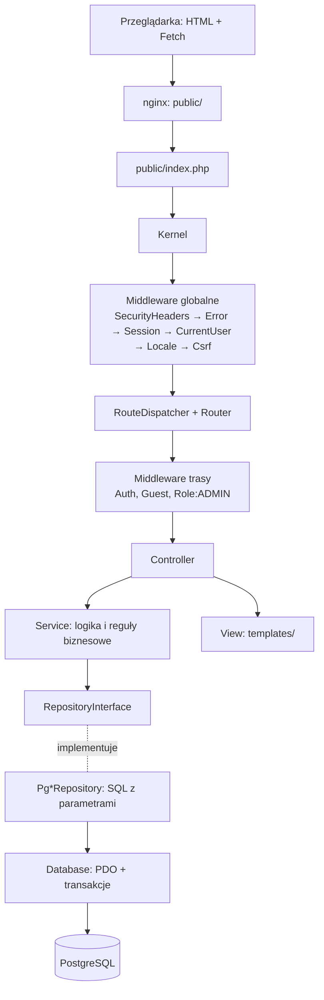
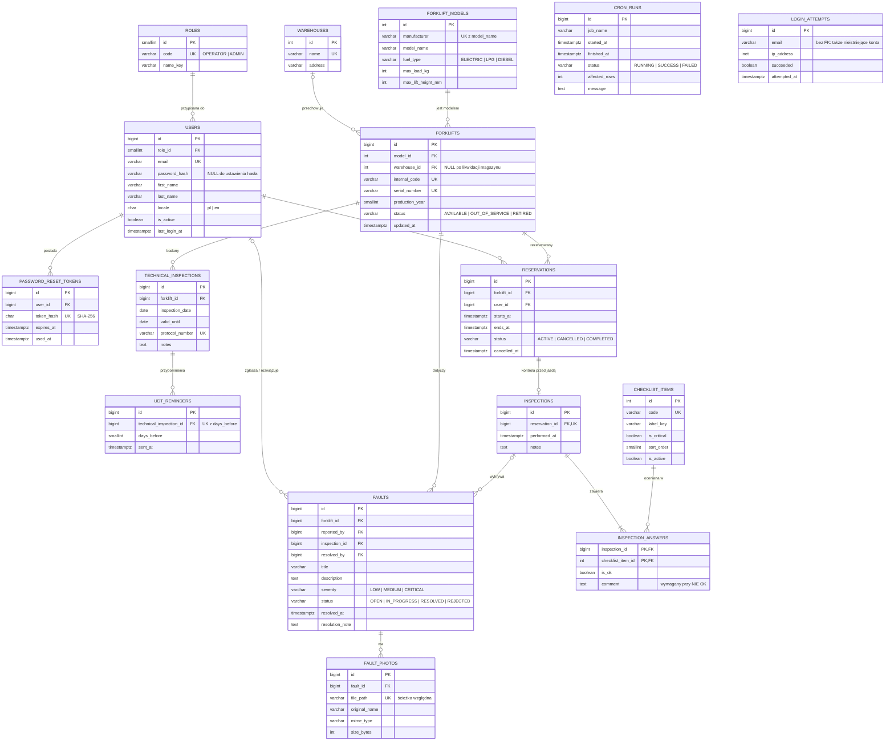

# Cargo

System do zarządzania flotą wózków widłowych w magazynie: rezerwacje na zmianę, kontrola przed jazdą, zgłaszanie usterek ze zdjęciami i pilnowanie terminów badań UDT.

## Opis problemu i główne funkcje

W magazynie kilkunastu operatorów korzysta z kilku wózków. Bez systemu trudno ustalić, kto i kiedy jeździ danym wózkiem i czy wykonał kontrolę przed jazdą. Usterki zgłasza się ustnie, a terminy badań UDT łatwo przegapić.

Główne funkcje:

- rezerwacja wózka na zmianę z podglądem dostępności,
- checklista kontroli przed jazdą,
- zgłaszanie usterek ze zdjęciami; usterka krytyczna automatycznie wyłącza wózek z eksploatacji,
- obsługa usterek, zarządzanie wózkami, badaniami UDT i użytkownikami (panel kierownika),
- przypomnienia e-mail o wygasających badaniach UDT.

## Architektura

Backend jest napisany obiektowo w PHP 8.4 bez frameworka. Router, kontener zależności, sesje i widoki są częścią projektu.



| Warstwa | Katalog | Odpowiedzialność |
|---|---|---|
| Punkt wejścia | `public/index.php`, `config/bootstrap.php` | Ładuje konfigurację, buduje kontener, uruchamia `Kernel` |
| HTTP | `src/Http` | `Request`/`Response`, router, middleware, mapowanie wyjątków na odpowiedzi |
| Kontrolery | `src/Controller` | Czytają żądanie, wywołują serwis, zwracają widok albo JSON. Bez SQL i bez HTML |
| Serwisy | `src/Service` | Logika biznesowa i transakcje |
| Repozytoria | `src/Repository` | Interfejsy oraz implementacje dla PostgreSQL |
| Baza | `src/Database` | Zapytania wyłącznie z parametrami, transakcje |
| Widoki | `src/View`, `templates/` | Szablony z layoutem i partialami. Wyjście kodowane przez `$this->e()` |
| Bezpieczeństwo | `src/Security` | Sesja, CSRF, Content Security Policy |
| Tłumaczenia | `src/I18n`, `lang/` | Katalogi PL/EN, wybór języka |
| Walidacja | `src/Validation` | Reguły i przetłumaczone komunikaty błędów |

**Kierunek zależności:** kontroler → serwis → interfejs repozytorium ← implementacja PostgreSQL. Klasy dostają zależności przez konstruktor. `Container` tworzy je automatycznie, a usługi wymagające konfiguracji są zdefiniowane w [config/services.php](config/services.php).

**Obsługa błędów:** każdy wyjątek trafia do `ErrorMiddleware`. Użytkownik dostaje stronę błędu w swoim języku, a dla ścieżek `/api/*` JSON `{"error": {"code", "message"}}`. Błędy 500 są logowane w kontenerze `app` (`docker compose logs app`). Szczegóły techniczne są widoczne tylko przy `APP_DEBUG=1`. Ostrzeżenia PHP są zamieniane na wyjątki, więc nie mogą przejść niezauważone.

## Diagram ERD bazy danych

Schemat: [database/migrations/002_schema.sql](database/migrations/002_schema.sql). Na diagramie są wszystkie tabele, klucze i istotne kolumny. Pominięte zostały tylko pomocnicze znaczniki czasu (`created_at`).



`CRON_RUNS` i `LOGIN_ATTEMPTS` nie mają relacji z innymi tabelami. Są to logi techniczne: wpis o próbie logowania musi powstać także dla adresu, który nie należy do żadnego konta.

### Zachowanie kluczy obcych przy usuwaniu

| Klucz obcy | ON DELETE | Uzasadnienie |
|---|---|---|
| `users.role_id` | RESTRICT | Nie usuwamy roli, do której są przypisani użytkownicy |
| `password_reset_tokens.user_id` | CASCADE | Token nie ma sensu bez użytkownika |
| `forklifts.model_id` | RESTRICT | Nie usuwamy modelu, który ma wózki |
| `forklifts.warehouse_id` | SET NULL | Po likwidacji magazynu wózek zostaje, tylko bez przypisania |
| `technical_inspections.forklift_id` | CASCADE | Badania są częścią historii wózka |
| `udt_reminders.technical_inspection_id` | CASCADE | Log przypomnień należy do badania |
| `reservations.forklift_id`, `reservations.user_id` | RESTRICT | Historia użycia jest ważna: wózki wycofujemy statusem `RETIRED`, konta dezaktywujemy |
| `inspections.reservation_id` | CASCADE | Kontrola istnieje tylko w ramach rezerwacji |
| `inspection_answers.inspection_id` | CASCADE | Odpowiedzi są częścią kontroli |
| `inspection_answers.checklist_item_id` | RESTRICT | Pozycję checklisty dezaktywujemy, a nie usuwamy |
| `faults.forklift_id` | RESTRICT | Historia usterek jest ważna |
| `faults.reported_by`, `faults.resolved_by`, `faults.inspection_id` | SET NULL | Zgłoszenie zostaje, nawet gdy powiązany rekord zniknie |
| `fault_photos.fault_id` | CASCADE | Zdjęcia są częścią zgłoszenia (pliki usuwa aplikacja) |

### Mechanizmy w bazie

| Obiekt | Rodzaj | Do czego służy |
|---|---|---|
| `reservations_forklift_no_overlap`, `reservations_user_no_overlap` | ograniczenia `EXCLUDE` | Rezerwacje jednego wózka i jednego operatora nie mogą się nakładać, nawet przy równoczesnych żądaniach |
| `trg_faults_critical_after_insert` | wyzwalacz | Usterka `CRITICAL` wyłącza wózek i anuluje jego przyszłe rezerwacje |
| `trg_forklifts_set_updated_at` | wyzwalacz | Aktualizuje `forklifts.updated_at` |
| `fn_forklift_is_available()` | funkcja | Sprawdza status, ważność UDT i kolizje rezerwacji w danym przedziale czasu |
| `v_forklift_overview` | widok | Lista wózków z modelem, magazynem, ważnością UDT i liczbą otwartych usterek |
| `v_monthly_usage` | widok | Raport miesięczny: godziny pracy i liczba usterek dla każdego wózka |

## Routing / endpointy

Trasy są zdefiniowane w [config/routes.php](config/routes.php). Router dopasowuje metodę HTTP i wzorzec ścieżki:

- `{name}`: dowolny segment, np. `/forklifts/{id}`,
- `{name:regex}`: segment pasujący do wyrażenia, np. `/lang/{locale:pl|en}`.

Nieistniejąca ścieżka zwraca **404**. Istniejąca ścieżka z inną metodą zwraca **405** z nagłówkiem `Allow`. Identyfikator, który nie jest dodatnią liczbą całkowitą (`Request::idParam()`), zwraca **400**. Każde żądanie inne niż GET musi zawierać token CSRF, w przeciwnym razie kończy się **403**.

| Metoda | Ścieżka | Kontroler | Dostęp | Opis |
|---|---|---|---|---|
| GET | `/` | `HomeController::index` | wszyscy | Przekierowanie na pulpit albo do logowania |
| GET | `/health` | `HealthController::show` | wszyscy | Stan aplikacji i połączenia z bazą (JSON, 200 albo 503) |
| GET | `/lang/{locale:pl\|en}` | `LocaleController::switch` | wszyscy | Zmiana języka (u zalogowanego zapisywana w profilu) i powrót na poprzednią stronę |
| GET, POST | `/login` | `AuthController` | gość | Logowanie. Limit 5 nieudanych prób na 15 min (429) |
| GET, POST | `/forgot-password` | `PasswordResetController` | gość | Wysłanie linku do resetu hasła (zawsze ta sama odpowiedź) |
| GET, POST | `/reset-password?token=…` | `PasswordResetController` | gość | Ustawienie nowego hasła jednorazowym tokenem |
| POST | `/logout` | `AuthController::logout` | zalogowany | Wylogowanie (wymaga CSRF) |
| GET | `/dashboard` | `DashboardController::index` | zalogowany | Pulpit |
| GET | `/api/me` | `Api\MeController::show` | zalogowany | Dane zalogowanego użytkownika (JSON). Bez sesji zwraca 401 |
| GET | `/admin/users` | `Admin\UserAdminController::index` | ADMIN | Lista kont. Operator dostaje 403 |

**Kontrola dostępu:** gość wchodzący na stronę chronioną jest przekierowany do `/login`, a po zalogowaniu wraca pod zapamiętany adres. Na ścieżkach `/api/*` dostaje 401. Zalogowany użytkownik bez wymaganej roli dostaje 403 niezależnie od tego, czy link był widoczny w menu.

*Kolejne trasy będą dochodzić w następnych etapach (plan: [PLAN.md, sekcja 6](PLAN.md)).*

## Uruchomienie przez Docker

### Wymagania

- Docker z Docker Compose v2 (Docker Desktop, OrbStack lub Docker Engine)
- Git

### Kroki

```bash
git clone <adres-repozytorium> cargo
```

```bash
cd cargo
```

```bash
cp .env.example .env
```

```bash
docker compose up --build
```

Przy pierwszym starcie kontener `app` instaluje zależności Composera, a `db` importuje `database/cargo.sql`.

### Usługi i porty

| Usługa | Rola | Adres na hoście |
|---|---|---|
| `web` | Nginx, serwuje `public/` i przekazuje żądania do PHP | http://localhost:8080 (`WEB_PORT`) |
| `app` | PHP 8.4-FPM z aplikacją | tylko w sieci Dockera (`app:9000`) |
| `cron` | Ten sam obraz PHP, uruchamia zadania cykliczne przez supercronic | brak |
| `db` | PostgreSQL 17, dane w wolumenie `pgdata` | `localhost:5433` (`DB_FORWARD_PORT`) |
| `mailpit` | Lokalna skrzynka do podglądu wysłanych e-maili | http://localhost:8025 (`MAILPIT_UI_PORT`) |

Kontenery komunikują się po nazwach usług: aplikacja łączy się z `db:5432` i wysyła pocztę na `mailpit:1025`.

### Przydatne polecenia

Odtworzenie bazy od zera (usuwa wolumeny z danymi i uploadami):

```bash
docker compose down -v
```

Konsola PHP w kontenerze aplikacji:

```bash
docker compose exec app sh
```

## Zmienne środowiskowe

Wszystkie zmienne są opisane w [.env.example](.env.example). Plik `.env` nie trafia do repozytorium.

| Zmienna | Opis |
|---|---|
| `APP_ENV`, `APP_DEBUG`, `APP_URL`, `APP_DEFAULT_LOCALE` | Tryb pracy, adres aplikacji, domyślny język |
| `WEB_PORT`, `MAILPIT_UI_PORT`, `DB_FORWARD_PORT` | Porty wystawione na hoście |
| `DB_HOST`, `DB_PORT`, `DB_NAME`, `DB_USER`, `DB_PASSWORD` | Połączenie z PostgreSQL (te same wartości inicjalizują kontener `db`) |
| `SESSION_NAME`, `SESSION_SECURE`, `SESSION_LIFETIME` | Ustawienia cookie sesji |
| `MAIL_HOST`, `MAIL_PORT`, `MAIL_USERNAME`, `MAIL_PASSWORD`, `MAIL_ENCRYPTION`, `MAIL_FROM_ADDRESS`, `MAIL_FROM_NAME` | Serwer SMTP |
| `UPLOAD_MAX_BYTES` | Maksymalny rozmiar jednego zdjęcia |
| `UDT_REMINDER_DAYS` | Ile dni przed końcem ważności badania UDT wysyłać przypomnienia |

## Import bazy i dane demonstracyjne

Plik [database/cargo.sql](database/cargo.sql) odtwarza cały schemat i dane demo na pustej bazie. Kontener `db` importuje go automatycznie przy pierwszym starcie, czyli wtedy, gdy wolumen `pgdata` jest pusty.

Plik jest generowany przez skrypt z migracji (`database/migrations`) i seedów (`database/seeds`). Po zmianie którejkolwiek z nich trzeba go wygenerować ponownie:

```bash
bin/build-sql.sh
```

Po pobraniu zmian z nową migracją trzeba odtworzyć bazę, bo skrypt importu działa tylko na pustym wolumenie. Ponowny import od zera (usuwa dane i uploady):

```bash
docker compose down -v && docker compose up --build
```

Import do istniejącej, pustej bazy bez Dockera:

```bash
psql -v ON_ERROR_STOP=1 -d cargo -f database/cargo.sql
```

### Konta demonstracyjne

Hasło każdego konta: `Cargo2026!`

| E-mail | Rola | Uwagi |
|---|---|---|
| `admin@cargo.local` | ADMIN | Kierownik: wózki, UDT, użytkownicy, usterki, raporty |
| `operator@cargo.local` | OPERATOR | Ma trwającą rezerwację WD-01 bez kontroli przed jazdą (demo checklisty) |
| `operator2@cargo.local` | OPERATOR | Interfejs i e-maile po angielsku |
| `nieaktywny@cargo.local` | OPERATOR | Konto dezaktywowane: logowanie jest odrzucane |

### Stan floty w danych demo

Daty są liczone względem chwili importu, więc scenariusze demo działają niezależnie od dnia uruchomienia.

| Wózek | Stan |
|---|---|
| WD-01, WD-02, WD-03, WD-07 | Dostępne. WD-01 i WD-07 są teraz w użyciu |
| WD-04 | Wyłączony przez wyzwalacz po zgłoszeniu usterki krytycznej (hamulce) |
| WD-05 | Badanie UDT wygasa za 10 dni (demo przypomnienia CRON) |
| WD-06 | Badanie UDT wygasło (rezerwacja jest odrzucana) |
| WD-08 | Wycofany z eksploatacji (`RETIRED`) |

## Testy

Testy jednostkowe (PHPUnit 12) są w katalogu [tests/Unit](tests/Unit). Są izolowane: nie korzystają z bazy ani z sesji PHP, tylko z atrap z [tests/Fake](tests/Fake).

Uruchomienie testów (przy działających kontenerach):

```bash
docker compose exec app composer test
```

Sprawdzenie składni wszystkich plików PHP:

```bash
docker compose exec app composer lint
```

| Obszar | Co sprawdzają testy |
|---|---|
| `RouterTest` | Trasa statyczna, parametr ścieżki, regex, 404, 405 z nagłówkiem `Allow`, grupy |
| `IdParamTest` | Poprawne id oraz 0, liczby ujemne, litery, zera wiodące, wartości poza zakresem `bigint` (400) |
| `CsrfTest`, `CsrfMiddlewareTest` | Token z formularza i z nagłówka, brak tokenu, zły token, regeneracja |
| `SafeRedirectTest` | Ochrona przed open redirect |
| `ValidatorTest` | Reguły, przycinanie danych, komunikaty w PL i EN, wyjątek 422 dla API |
| `TranslatorTest`, `LocaleMiddlewareTest` | Tłumaczenia, parametry, identyczne klucze PL/EN, wybór języka |
| `ContainerTest` | Automatyczne tworzenie zależności i czytelne błędy konfiguracji |
| `AuthServiceTest` | Poprawne logowanie, złe hasło, nieznany e-mail, konto nieaktywne, konto bez hasła, blokada po 5 próbach, regeneracja sesji i tokenu CSRF, utrata dostępu po dezaktywacji |
| `PasswordResetServiceTest` | Link w języku odbiorcy, w bazie tylko hash tokenu, token jednorazowy i wygasający, nowy link unieważnia stary, błąd SMTP nie ujawnia informacji |
| `AuthorizationTest`, `AccessMiddlewareTest` | Uprawnienia ról, 302 lub 401 dla gościa, 403 dla złej roli, `Cache-Control: no-store` |

## Logowanie, sesja i role

| Mechanizm | Implementacja |
|---|---|
| Hasła | `password_hash`/`password_verify` (bcrypt) w [PasswordHasher](src/Security/PasswordHasher.php). Przy nieistniejącym koncie sprawdzany jest hash zastępczy, więc czas odpowiedzi nie zdradza, które e-maile są w bazie |
| Komunikat błędu | Zły e-mail, złe hasło i konto nieaktywne dają ten sam komunikat „Nieprawidłowy e-mail lub hasło” |
| Limit prób | 5 nieudanych prób na 15 minut dla pary e-mail + IP (tabela `login_attempts`), potem odpowiedź 429 |
| Sesja | Po zalogowaniu `session_regenerate_id(true)` i nowy token CSRF. W sesji jest tylko `user_id`. Rola i status konta są czytane z bazy przy każdym żądaniu. Cookie `HttpOnly`, `SameSite=Lax`, `Secure` na produkcji. Sesja wygasa po `SESSION_LIFETIME` sekundach bezczynności |
| Role | `OPERATOR` i `ADMIN` w tabeli `roles`. Trasy `/admin/*` chroni `RoleMiddleware:ADMIN`, a widoki pytają `Authorization` o uprawnienia (`Ability`) |
| Wylogowanie | `POST /logout` z tokenem CSRF: czyści dane sesji, usuwa ją na serwerze i wygasza cookie. Strony chronione mają `Cache-Control: no-store`, więc przycisk Wstecz nie pokazuje ich z pamięci przeglądarki |
| Reset hasła | Jednorazowy token `random_bytes(32)` ważny 60 minut. W bazie jest tylko jego SHA-256. Nowy link unieważnia poprzednie |

## Raport WCAG

*(w przygotowaniu)*

## Security Bingo

*(w przygotowaniu)*

## Zadanie CRON i wysyłka e-mail

### E-mail

Wiadomości wysyła [PhpMailerMailer](src/Mail/PhpMailerMailer.php) przez SMTP. Dane serwera pochodzą ze zmiennych `MAIL_*`. Treść powstaje z szablonów [templates/emails](templates/emails) w języku odbiorcy (`users.locale`) i ma wersję HTML oraz tekstową. Błąd SMTP jest logowany i nie przerywa operacji użytkownika.

Lokalnie wszystkie wiadomości trafiają do Mailpit: http://localhost:8025. Żeby to sprawdzić, wejdź na http://localhost:8080/forgot-password, podaj `operator2@cargo.local` i otwórz wiadomość w Mailpit (będzie po angielsku, zgodnie z profilem).

| Wiadomość | Kiedy |
|---|---|
| Link do ustawienia nowego hasła | Formularz „Nie pamiętasz hasła?” |

### CRON

*(w przygotowaniu: przypomnienia o badaniach UDT, zamykanie zakończonych rezerwacji, czyszczenie wygasłych tokenów)*

## Deploy

*(w przygotowaniu)*
